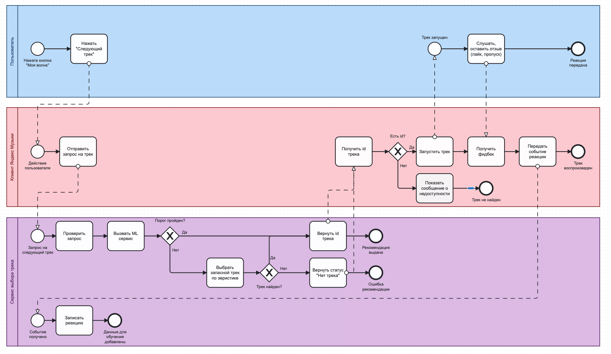
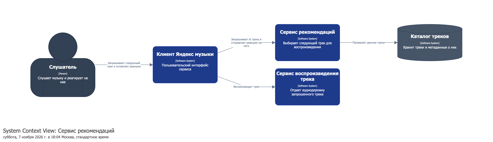
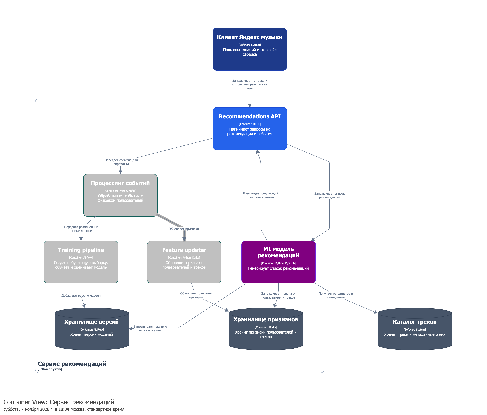
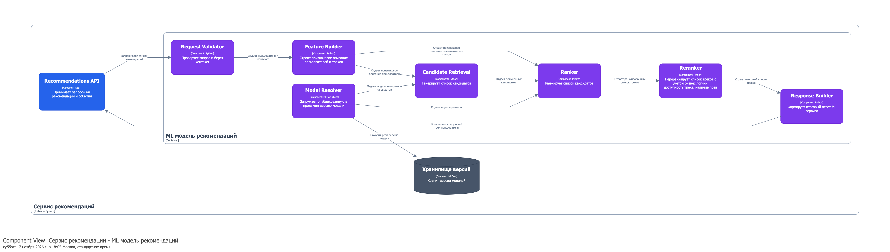

# Архитектура сервиса "Моя волна" Яндекс Музыки

## Границы процесса

**Старт:** слушатель нажал «Следующий трек» при работе «Моей волны». Клиент отправляет запрос на следующий трек.

**Успешный результат:** приложение получило track_id, передало его сервису воспроизведения и начало воспроизведение следующего трека.

**Ошибка**: ml выдал трек с малым скором или фоллбэк не сработала, что возвращается сообщение о недоступности

**In-scope:** Оркестратор запросов, ml рекомендации, feature store, обработка событий, ретрейн и публикация новой модели, обновление признаков

**Out-of-scope:** устройство интерфейса пользователя, архитектура каталога, передача аудио 

**Получатель результата:** оркестратор -> клиент Яндекс мызыки -> слушатель

## ML задача

Тип задачи: ранжирование треков

Входные данные: user_id, session_id, request_id, контекст, признаки из feature store

Выходные данные: track_id, score, model_version

Условия:
- score > threshold = 0.3 (модель выдает вероятности)
- время ответа < 300 ms
- иначе вызывается fallback - легкая модель или эвристика

## Файлы

- `/bpmn` - содержит исходные файлы диаграммы BPMN ([bpmn.io](https://demo.bpmn.io/))

- `/c4` - содержит диаграммы С4 уровней Context, Containers и Components ([Structurizr](https://structurizr.com))

    **Context:**
    

    **Containers:**
    

    **Components:**
    

## Соответствие BPMNN и C4:

Описание соответствий событие в bpmn - контейнер C4 (Containers)

- Отправить запрос - Клиент Яндекс Музыки

- Вызвать ML сервис - Recommendation API

- Вызвать фоллбек - Recommendation API

- Вернуть track_id клиенту - Клиент Яндекс Музыки

- Запустить воспроизведение - Клиент Яндекс Музыки

- Получить реакцию - Процессинг событий

- Записать реакцию - Training pipeline, Feature updater

## Допущения

- ML сервис использует каскадную модель из кандгена, ранжирования и переранжирования

- Используется логика онлайн рекомендации

- Ранкер выдает вероятности

- Фоллбек - эвристика популярности

- Все признаки хранятся в Redis

- События передаются через Kafka

